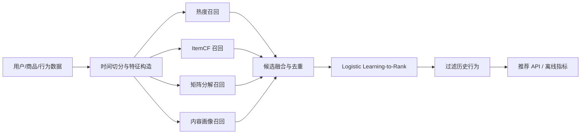

# 租赁商品推荐系统

这是一个面向租赁业务的可复现推荐系统工程。它把原目录中的用户画像、商品特征编码、ALS/ItemCF/多路召回和 xDeepFM 精排思路整理成一个可以脱离公司数据运行的闭环：生成脱敏样例数据，按时间切分训练集/测试集，进行三路召回，使用学习排序模型融合候选集，输出离线指标，并通过 FastAPI 提供推荐接口。

默认数据是本地确定性生成的租赁行为数据，字段和业务语义来自原项目中的用户、商品、租金、城市、品类和行为标签设计，不包含公司数据、账号或密钥。之后接入公开 CSV 或脱敏数仓表时，只需把数据适配成相同的三张表即可。

## 快速运行

需要 Python 3.10+。

```bash
cd rental_reco
python -m venv .venv
# Windows PowerShell
.\.venv\Scripts\Activate.ps1
python -m pip install -e ".[dev]"
python -m rental_reco.cli demo
```

命令会训练默认规模的数据集，打印 `Recall@K`、`HitRate@K`、`NDCG@K`、商品覆盖率和一个用户的推荐结果，并把指标写入 `artifacts/metrics.json`，同时把本次生成的数据保存到 `artifacts/data/`。调整规模示例：

```bash
python -m rental_reco.cli demo --users 500 --items 300 --top-k 20
```

训练结果同时保存为 `artifacts/pipeline.pkl`。有公开或脱敏数据时，可以按下方数据契约放入同一个目录后运行：

```bash
python -m rental_reco.cli demo --data-dir ./data
```

目录需要包含 `users.csv`、`items.csv`、`interactions.csv` 三个文件；字段校验由 `load_csv_bundle` 完成。

启动 API：

```bash
python -m rental_reco.cli serve --port 8000
```

然后访问 `http://127.0.0.1:8000/docs`，或调用：

```bash
curl "http://127.0.0.1:8000/recommend/u0001?k=10"
```

运行测试：

```bash
pytest
```

## 系统结构



核心模块：

- `data.py`：生成脱敏租赁数据，按用户时间切分，避免把未来行为泄漏到训练集。
- `recall.py`：热度、ItemCF、矩阵分解和内容画像四路召回，按加权倒数排名融合，并保留 `recall_sources` 解释字段。
- `features.py`：统一构造用户、商品和交叉特征，训练和在线推理使用同一份逻辑。
- `ranking.py`：用负采样构造排序样本，`DictVectorizer + LogisticRegression` 作为稳定、可解释的精排基线。
- `evaluation.py`：计算 Recall@K、HitRate@K、NDCG@K、Item Coverage，并使用时间留出集。
- `api.py`：提供 `/health`、`/metrics` 和 `/recommend/{user_id}`。

## 数据契约

`users` 至少包含 `user_id`、`city`、`age_bucket`、`gender`、`budget_level`、`preferred_categories`；`items` 至少包含 `item_id`、`category`、`brand`、`city`、`condition`、`daily_rent`、`quality_score`；`interactions` 至少包含 `user_id`、`item_id`、`event_type`、`label`、`timestamp`。因此可以将公开租赁/电商行为数据映射为同一结构，算法层无需改动。

## 简历项目描述

**租赁商品个性化推荐系统｜Python、Pandas、Scikit-learn、FastAPI**

- 面向租赁商品推荐场景，设计“数据处理-多路召回-候选融合-学习排序-在线服务-离线评估”完整链路，解决冷启动、历史去重和推荐解释问题。
- 基于热度、ItemCF 和用户画像内容三路召回，使用加权倒数排名融合候选集，保留召回来源用于线上解释和问题排查。
- 构造时间切分和用户级负采样训练集，统一用户、商品、城市、品类、预算和租金差等特征，训练可解释的 Logistic Learning-to-Rank 模型。
- 使用 Recall@K、HitRate@K、NDCG@K、Item Coverage 评估推荐质量，提供确定性样例数据、CLI、FastAPI 和 pytest，支持本地一键复现。

实际业务接入时，可以将精排基线替换为原项目实验过的 xDeepFM/DIEN，将召回计算迁移到 Spark/MaxCompute，并把 ItemCF 相似度写入 OpenSearch 或向量检索服务；当前工程保留了清晰的模块边界和数据契约。

## 安全说明

新工程不读取或保存公司账号、Webhook、手机号或 MaxCompute 凭证。原目录中的旧同步脚本仅作为历史参考；接入真实数据时，应使用环境变量或密钥管理服务，并把数据同步逻辑放到独立适配器中。
